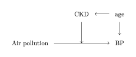

# Simulation and priors

The first exercise is to simulate a dataset.

## Simulating data

We'll simulate data on air pollution (AP), chronic kidney disease (CKD), age, and systolic blood pressure (BP).
Remember that we don't need to make it super realistic, but if the variables and their relationships  kinda make sense, it's easier to think about.

{#fig-dag fig-align="left" width="50%"}

In our dataset, AP exposure increases BP and having CKD makes this effect stronger. 
With older age, the risk to develop CKD increases, and so does BP.

Let's first set up the workspace. 

```{r}
#| label: load_packages
#| include: false

library(rethinking)
set.seed(146)
```

### Air pollution

We start by simulating the independent variables, which are AP and age in this case.
We could imagine different air pollutants here, but we'll go with a common one: PM~2.5~.
We set the concentration that the simulated values will fall around with `mean_PM`.
We also add noise around that value with `rnorm` and exponentiate the whole thing so that all simulated AP values are positive. 

```{r}
#| label: sim_AP

n <- 1000 # simulating 1000 individuals
mean_PM <- 10
AP <- exp(log(mean_PM) + rnorm(n, 0, 0.3))
summary(AP)
```

### Age

Simulating age is very straightforward.
We use the uniform distribution so that the whole range between 55 and 95 years is covered nicely.

```{r}
#| label: sim_age

age <- round(runif(n, 55, 95))
summary(age)
```


### Chronic kidney disease

CKD is a dependent variable, with age increasing the risk.

{#fig-dag fig-align="left" width="50%"}

This is why we first set the "beta" for age and CKD, so how much the risk to develop CKD increases with each year.

```{r}
#| label: beta_age_CKD

b_age_CKD <- 0.3
```

I set it to `r b_age_CKD` here, which is definitely not evidence-based :') 

CKD status is binary, so we need to assign yes / no to everybody.
But this assignment should be based on age. 
Sooo... ?? 

We first assign a *probability* to have CKD to everybody.

```{r}
#| label: prob_CKD

prob_CKD <- inv_logit(-2.5 + ((age - mean(age)) * b_age_CKD))
prob_CKD[1:5]
```

Above, we center the age variable by subtracting the mean from everybody's age, then we multiply by the "beta" from above.
`inv_logit` bounds everything between 0 and 1 (which we need here, because we want *probabilities*) and the -2.5 means "not very likely" in log-space.
So the "baseline risk" to have CKD is low.
(Btw, we set -2.5 by just trying different values and looking at the results. No magic here.)

The next step is more straightforward again, we just sample from a Bernoulli distribution.

```{r}
#| label: sim_CKD

CKD <- rbern(n, prob_CKD) + 1
table(CKD)
```

### Systolic blood pressure

Now we want to add a blood pressure value for each person in the sample.
We first set the effects of age, AP and CKD status on BP as well as an intercept and noise for BP.

```{r}
#| label: effects_BP

a_BP <- 110
b_age_BP <- 0.27
b_AP_BP <- c(1.3, 2)
sigma_BP <- 5
```

`b_AP_BP` creates the interaction: the effect of air pollution on BP is `r b_AP_BP[1]` for people without CKD and `r b_AP_BP[2]` for people with CKD.

Now we are ready to simulate BP. 
We sample from a normal distribution again and use the effects we set above together with the variables we have simulated to "modify" the mean.
Then we just add a bit of noise (`sigma_BP`) and round the results.

```{r}
#| label: sim_BP

BP <- round(
  rnorm(
    n,
    mean = a_BP +
      b_age_BP * age +
      b_AP_BP[CKD] * AP,
    sd = sigma_BP
  ),
  1
)
```

The last thing we'll add is an ID variable.

```{r}
#| label: id

id <- c(1:n)
```

Now we add everything to a dataframe and save it.

```{r}
#| label: save_data

data <- data.frame(
  id,
  age,
  BP,
  CKD,
  AP
)

write.csv(data, "data/data.csv", row.names = FALSE)
```

## Plotting the data

Let's plot the data.

```{r}
#| label: plot_AP_BP
#| code-fold: true
#| fig-width: 9
#| fig-height: 4

library(tidyplots)

data$CKD <- as.factor(data$CKD)

data |>
  tidyplot(x = AP, y = BP, color = CKD) |>
  add_data_points(alpha = 0.7) |>
  # add_curve_fit(method = "lm") |>
  adjust_y_axis_title("systolic blood pressure") |>
  adjust_x_axis_title("air pollution") |>
  adjust_size(width = 90, height = 80) |>
  adjust_font(fontsize = 10)
```


```{r}
#| label: plot_age_BP
#| code-fold: true
#| fig-width: 9
#| fig-height: 4

data |>
  tidyplot(x = age, y = BP, color = CKD) |>
  add_data_points(alpha = 0.7) |>
  # add_curve_fit(method = "lm") |>
  adjust_y_axis_title("systolic blood pressure") |>
  adjust_x_axis_title("age") |>
  adjust_size(width = 90, height = 80) |>
  adjust_font(fontsize = 10)
```


Looks okay to me. Great! Now we can move on to modeling :)

# Parameter estimation

## Statistical model

$$
\begin{aligned}
\text{BP}_i &\sim \mathcal{N}(\mu_i, \sigma) \\
\mu_i &= \alpha + \beta_{\text{AP}[\text{CKD}[i]]} \text{AP}_i + \beta_{\text{age}} \text{age}_i \\
\alpha &\sim \mathcal{N}(120, 10) \\
\beta_{\text{AP}[j]} &\sim \mathcal{N}(1.5, 2) \\
\beta_{\text{age}} &\sim \mathcal{N}(0, 2) \\
\sigma &\sim \operatorname{Exponential}(1)
\end{aligned}
$$

## Prior prediction

Let's check if our priors make sense.
We draw 20 values from the priors for $\alpha$ and $\beta_{\text{AP}}$ (here we just check the prior for no CKD, but we could of course look at both).
Then we plot all of these lines.
This plot tells us which relationships between AP and BP the prior "thinks" are possible.

```{r}
#| label: prior_pred_sim_AP_BP
#| cache: false

n <- 20
sim_a <- rnorm(n, 120, 10)
sim_b_AP <- rnorm(n, 1.5, 2)

AP_seq <- seq(from = 1, to = 30, length.out = 30)

plot(
  NULL,
  xlim = c(1, 30),
  ylim = c(80, 160),
  xlab = "air pollution",
  ylab = "blood pressure"
)
for (i in 1:n) {
  mu <- sim_a[i] + sim_b_AP[i] * AP_seq
  lines(AP_seq, mu, lwd = 1, col = "#870052")
}
```

Looks good!

Now we continue with age and blood pressure:

```{r}
#| label: prior_pred_sim_age_BP
#| cache: false

n <- 20
sim_a <- rnorm(n, 120, 10)
sim_b_age <- rnorm(n, 0, 2)

age_seq <- seq(from = 55, to = 95, length.out = 40)

plot(
  NULL,
  xlim = c(55, 95),
  ylim = c(80, 160),
  xlab = "age",
  ylab = "blood pressure"
)
for (i in 1:n) {
  mu <- sim_a[i] + sim_b_age[i] * age_seq
  lines(age_seq, mu, lwd = 1, col = "#870052")
}
```

This is not ideal, but okay for our purpose, because we have enough data.
We could have improved the prior for age by centering the variable, so that we set it for the *mean* age (as we did when assigning the probabilities to have CKD).
Here, we instead set the prior for a newborn, which is a bit less intuitive and harder to do right.

## Fitting the model

Now we are ready to fit the model.
Notice how similar the model code is to our simulation code and the statistical model!
Once you have these things, it's really easy to fill out the model. 

```{r}
#| label: model
#| include: false

data <- as.list(read.csv("data/data.csv"))

m_AP_BP <- ulam(
  alist(
    BP ~ dnorm(mu, sigma),
    mu <- a + b_AP_BP[CKD] * AP + b_age_BP * age,
    a ~ dnorm(120, 10),
    b_AP_BP[CKD] ~ dnorm(1.5, 2),
    b_age_BP ~ dnorm(0, 2),
    sigma ~ dexp(1)
  ),
  data = data,
  chains = 4,
  iter = 1000
)
```

Let's see whether the model recovered the parameters we set in the simulation!

```{r}
#| echo: false
#| comment: ""

true_values <- list(
  a_BP = a_BP,
  b_AP_BP = b_AP_BP,
  b_age_BP = b_age_BP,
  sigma_BP = sigma_BP
)

for (name in names(true_values)) {
  values <- paste(round(true_values[[name]], 2), collapse = ", ")
  cat(sprintf("%-10s = %s\n", name, values))
}
```

```{r}
#| label: precis

precis(m_AP_BP, depth = 2)
```

```{r}
#| label: precis_save
#| include: false
#| echo: false

precis <- precis(m_AP_BP, depth = 2)
```

Isn't that satisfying <:

# Model validation & visualization
Before we explore what we can do with these results, we should look at a few things to make sure the model worked fine.
This is of course way more important when working with real data, because we obviously can't just check if our model found the "real" effects.

## Identify issues in estimation
There are a few things we can easily check in every model. 
These give us hints on whether we can trust the model.

### Rhat
In the `precis` output above, the $\hat{R}$ value (`rhat`) indicates whether the four Markov chain Monte Carlo (MCMC) chains have converged, meaning if they agree with each other.
A value of less than 1.01 is generally considered good.\
All of our $\hat{R}$ values are below 1.01, which is good! 
But of course, a good $\hat{R}$ value doesn't mean that the model is right.
The chains could converge on the same wrong answer.

### Effective Sample Size (ESS)
<!-- In the right column, we also find `ESS_bulk`.
These values tell us something about how much we can trust our results (for the _bulk_ of our posterior distribution). \ -->
When the MCMC algorithm moves around the parameter space we want to learn about, each new step (or iteration) is dependent on the last one.
This means that the samples we generate are somewhat correlated.
The ESS value gives us an idea of how many _truly independent_ samples would give us the same quality of information as the correlated samples.
Let's take one of our parameters, `b_age_BP` as an example.
The ESS for the bulk of the posterior distribution is `r round(precis$ess_bulk[4], 0)`.
This means that, in simple terms, our estimate is as good as `r round(precis$ess_bulk[4], 0)` independent samples. 
This corresponds to `r round(precis$ess_bulk[4] / ((1000 / 2) * 4), 2)*100`% of our total samples, which is good.

### Trace Plots

Now we'll have a look at how the four chains moved around to explore the posteriors of the parameters.

```{r}
#| label: traceplot_1
#| code-fold: true

old_par <- par(xaxt = "n")

traceplot(
  m_AP_BP,
  lwd = 1,
  col = c("#45032c", "#6f0344", "#aa166f", "#eca7c9")
)

par(old_par)
```

Above, you can see the "history" of the four chains exploring our five parameters. 
The x -xis shows the number of iterations.
The shaded first half of the sampling process was used as warmup and is discarded in the results.
You can really see how the chains needed a few iterations just to get to the right area of the posterior.
There are smart ways to tell the sampler where it should start sampling, but as you can see, the chains settled quite fast, so this is okay.
But in order to judge whether the chains have converged or not, we should "zoom" into the second half of sampling:

```{r}
#| label: traceplot_2
#| code-fold: true

old_par <- par(xaxt = "n")

traceplot(
  m_AP_BP,
  window = c(501, 1000),
  lwd = 1,
  col = c("#45032c", "#6f0344", "#aa166f", "#eca7c9"),
  bg = "white"
)

par(old_par)
```

This looks like the chains agree with each other.
If some of the chains would have been stuck in some region and you could distinguish them from one another, that would be a sign that something went wrong. 
You can see a few examples of bad looking traceplots [here](https://arviz-devs.github.io/EABM/Chapters/MCMC_diagnostics.html#trace-plots). 

## Visualize the results
Now let's visualize our results!

Okay, now lets look at the data and the line at the posterior mean plotted (black) and 20 samples from the posterior (grey):
```{r}
#| label: prep_vis_post_AP_BP

post_samples <- extract.samples(m_AP_BP)

Xseq <- seq(from = 1, to = 30, by = 0.5)

n_samples <- length(post_samples$a)
n_x <- length(Xseq)

age_value <- mean(data$age)
no_ckd_group <- 1
ckd_group <- 2

mu_matrix <- matrix(NA, nrow = n_samples, ncol = n_x)

for (j in 1:n_x) {
  x_value <- Xseq[j]

  # one μ per posterior sample at this x value
  mu_matrix[, j] <- post_samples$a +
    post_samples$b_AP_BP[, ckd_group] * x_value +
    post_samples$b_age_BP * age_value
}

# now summarise each column (= each x value)
mu_mean <- apply(mu_matrix, 2, mean)
mu_q02 <- apply(mu_matrix, 2, quantile, probs = 0.02)
mu_q25 <- apply(mu_matrix, 2, quantile, probs = 0.25)
mu_q75 <- apply(mu_matrix, 2, quantile, probs = 0.75)
mu_q98 <- apply(mu_matrix, 2, quantile, probs = 0.98)
plot_df <- data.frame(Xseq, mu_mean, mu_q02, mu_q25, mu_q75, mu_q98)
```

```{r}
#| label: vis_post_AP_BP
#| fig-width: 9
#| fig-height: 4

library(tidyplots)
library(ggplot2)

plot_df |>
  tidyplot(x = Xseq, y = mu_mean) |>
  add(geom_ribbon(
    aes(x = Xseq, ymin = mu_q02, ymax = mu_q98),
    fill = "#eca7c9",
    alpha = 0.4,
    inherit.aes = FALSE
  )) |>
  add(geom_ribbon(
    aes(x = Xseq, ymin = mu_q25, ymax = mu_q75),
    fill = "#aa166f",
    alpha = 0.4,
    inherit.aes = FALSE
  )) |>
  add_line(color = "#45032c") |>
  adjust_x_axis_title("Air pollution") |>
  adjust_y_axis_title("Blood pressure (mmHg)") |>
  adjust_size(width = 90, height = 80) |>
  adjust_font(fontsize = 10)
```

# Postprocessing
## Downstream quantities
### Attributable cases of high BP (>130)
What if AP was 0 for everybody?
What if AP was below 5 for everybody?
What if we prevented all CKD?